<a href="https://www.cleverproject.lk">
  
</a>

<p align="center">
  <a href="https://git.io/typing-svg">
    
  </a>
</p>

<p align="center">
  <a href="https://www.cleverproject.lk"></a>
  <a href="https://www.fiverr.com/indurukeshara"></a>
  
  
</p>

<br/>

## ✦ About

```ts
const mike = {
  role:     "Engineer across mobile, web, data & web3",
  building: "Clever Project — products for Sri Lankan businesses",
  shipped:  "180+ features across startups & client work",
  stack: {
    mobile:  ["Flutter", "Dart", "Kotlin"],
    web:     ["React", "Next.js", "Tailwind"],
    backend: ["Node", "FastAPI", "PostgreSQL", "MongoDB"],
    ai:      ["PyTorch", "TensorFlow", "OpenCV"],
    web3:    ["Solidity"],
    ops:     ["Docker", "CI/CD", "Linux"],
  },
  motto:    "Let's build something real.",
};
```

<p align="center">
  <a href="https://app.lottiefiles.com/animation/9e92ac8e-7eee-4e6e-b1b1-c9a032913855">
    
  </a>
</p>

## ✦ Products I build & run

<p align="center">
  <a href="https://amigotap.com/"></a>
</p>

<table align="center">
  <tr>
    <td width="50%"><a href="https://mobile-apo-web.vercel.app/"></a></td>
    <td width="50%"><a href="https://seettuweb.vercel.app/"></a></td>
  </tr>
  <tr>
    <td width="50%"><a href="https://fixitweb-psi.vercel.app/"></a></td>
    <td width="50%"><a href="https://fixitweb-7w8f.vercel.app/"></a></td>
  </tr>
</table>

## ✦ Toolbox

<p align="center">
  <br/>
  <br/>
  <br/>
  
</p>

## ✦ GitHub in numbers

<p align="center">
  
  
</p>

<p align="center">
  
</p>

<p align="center">
  
</p>

<p align="center">
  
</p>

<p align="center">
  <picture>
    <source media="(prefers-color-scheme: dark)" srcset="https://raw.githubusercontent.com/thelllmike/thelllmike/output/snake-dark.svg" />
    <source media="(prefers-color-scheme: light)" srcset="https://raw.githubusercontent.com/thelllmike/thelllmike/output/snake-light.svg" />
    
  </picture>
</p>

## ✦ Let's connect

<p align="center">
  <a href="https://linkedin.com/in/thellmike"></a>
  <a href="https://twitter.com/thelllmike"></a>
  <a href="https://stackoverflow.com/users/thellmike"></a>
  <a href="https://facebook.com/cleverprojects"></a>
  <a href="https://instagram.com/clever.project"></a>
  <a href="https://tiktok.com/@cleverproject"></a>
</p>

<p align="center">
  <a href="https://buymeacoffee.com/thellmike"></a>
</p>


